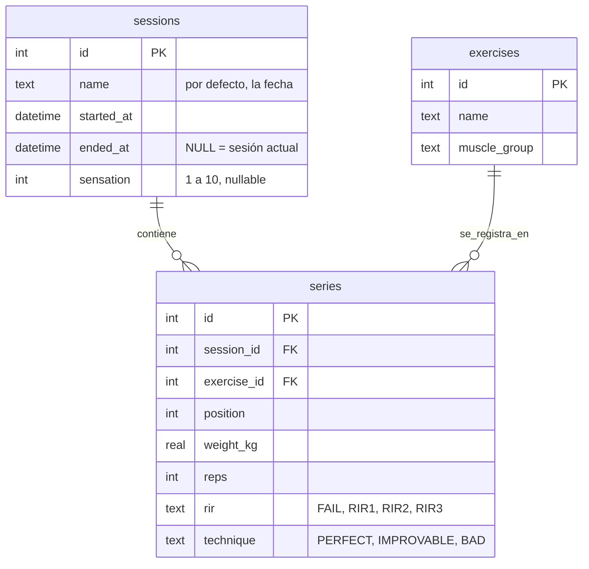
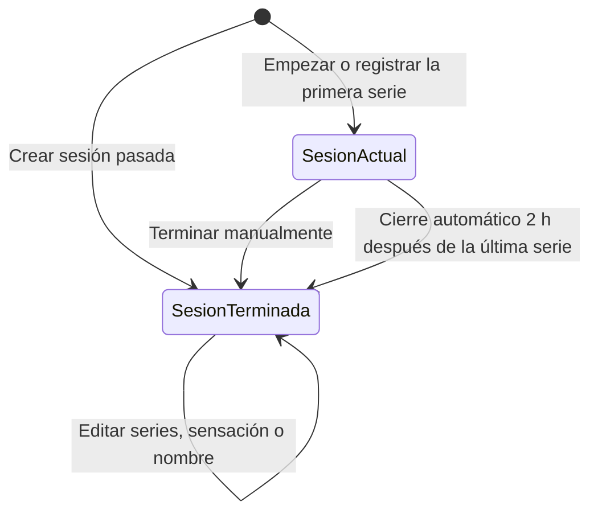
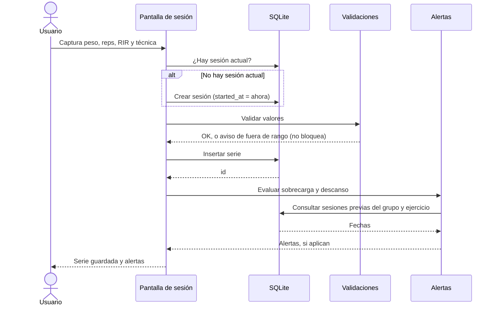
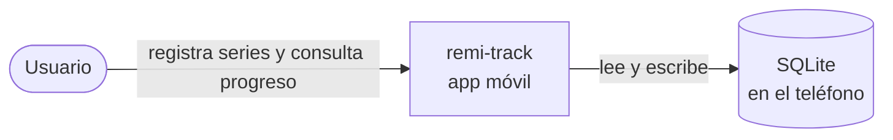
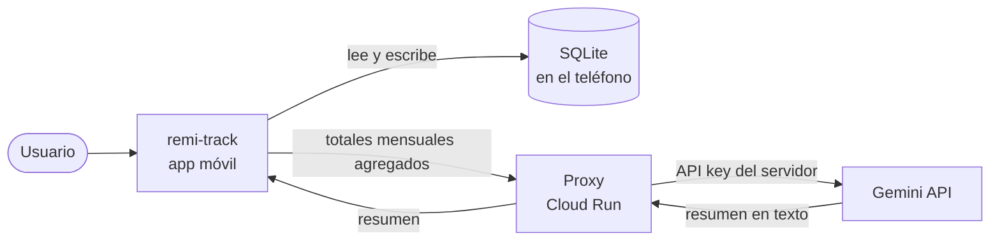

# Arquitectura de remi-track

Versión 0.4, beta sin IA. Los datos viven solo en el teléfono y no hay llamadas a servicios externos.

## Modelo de datos (SQLite)

Decisiones que este diagrama fija:

- **Las series apuntan directo al ejercicio.** No hay tabla intermedia `session_exercises`. Así hay menos joins, y el orden se guarda en `position`.
- **El estado de la sesión se deduce de `ended_at`.** Si es nulo, la sesión está en curso. No hay columna de estado.
- **Una sola sesión actual a la vez.** Se garantiza con un índice único parcial: `CREATE UNIQUE INDEX one_current_session ON sessions(ended_at) WHERE ended_at IS NULL;`
- **El volumen semanal y mensual no se guarda.** Se calcula con consultas. Guardarlo crearía datos que pueden quedar desincronizados.
- **`sensation` y `name` son opcionales al crear la sesión.** La sensación se captura al terminar, y el nombre tiene la fecha como valor por defecto.
- **Un ejercicio con series no se puede borrar.** Si el catálogo cambia, se marca como inactivo.
- **Índices sugeridos:** `series(exercise_id, session_id)` para las gráficas por ejercicio, y `sessions(started_at)` para filtrar por semana y mes.

## Ciclo de vida de una sesión

Una sesión se crea de tres formas: al tocar "Empezar", al registrar una serie sin sesión actual, o como sesión pasada desde el historial, con fecha y hora editables.

Se termina de dos formas: manualmente, con "Terminar sesión", o automáticamente 2 horas después de la última serie. En el cierre automático, `ended_at` toma la hora de la última serie y no la hora del cierre, para que la duración no se infle.

## Flujo de registrar una serie

Este flujo tiene una decisión importante: las alertas se evalúan después de guardar la serie, no antes. Así un error en la lógica de alertas nunca impide registrar el entrenamiento, que es lo más importante de la app.

## Diagrama de contexto (beta)

La beta no tiene ninguna conexión externa. Todo ocurre en el teléfono.

## Diagrama de contexto (versión 1.1, planeado)

En la versión 1.1, la app nunca llama a Gemini directo. El proxy guarda la key, aplica el límite de cuota y reenvía solo totales agregados. Ver el ADR de IA fuera de la beta.

## Casos de uso de la beta

Mermaid no tiene un tipo nativo de casos de uso, así