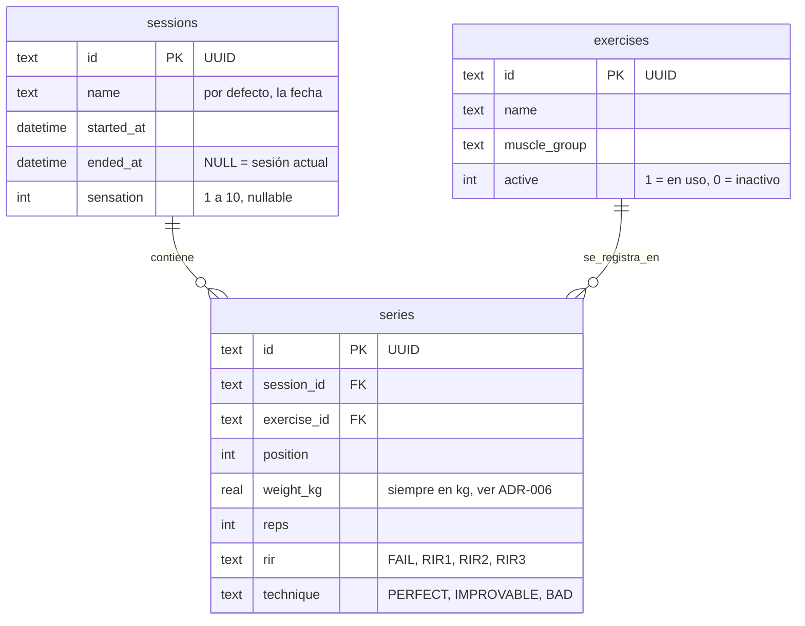
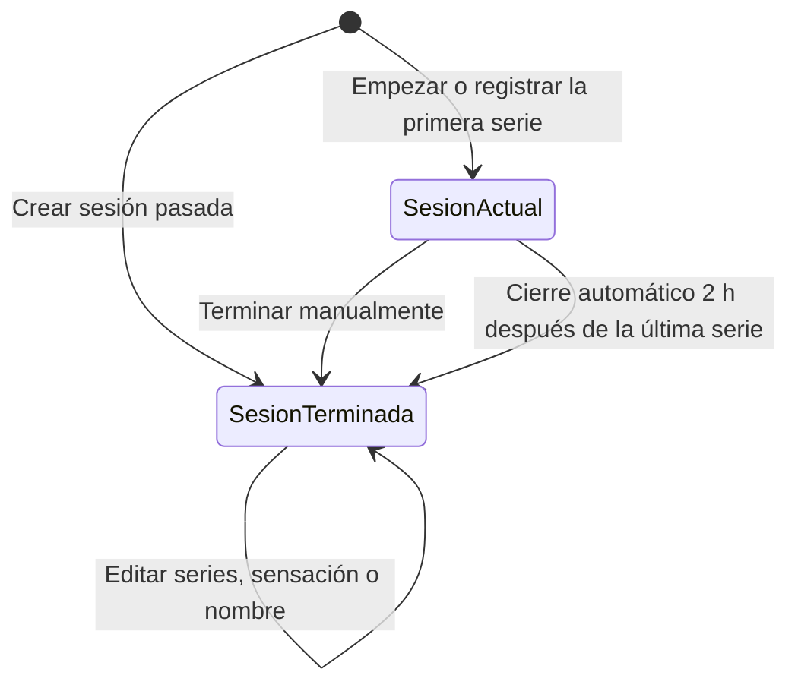
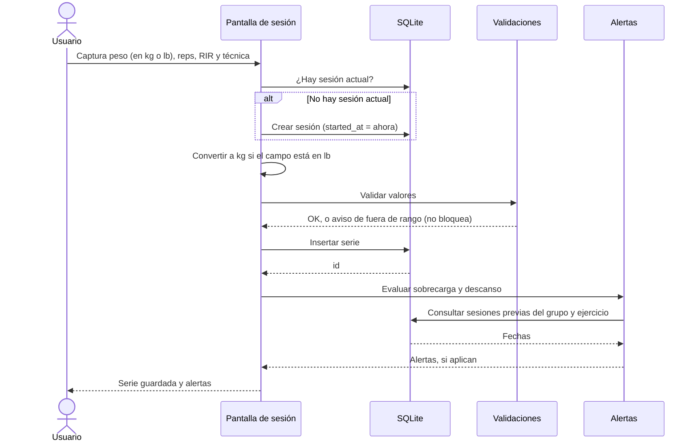
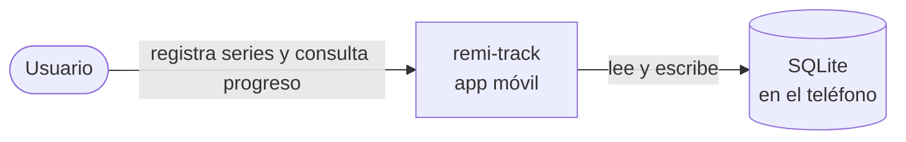
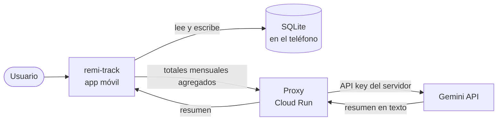
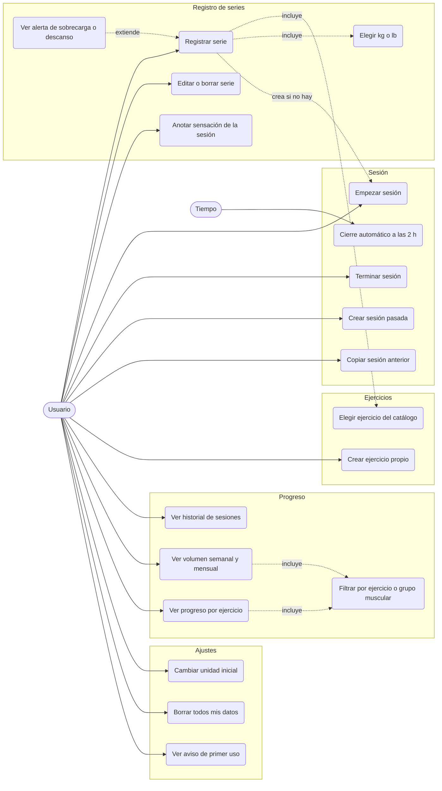

# Arquitectura de remi-track

Versión 0.5, beta sin IA. Los datos viven solo en el teléfono y no hay llamadas a servicios externos.

## Modelo de datos (SQLite)

Decisiones que este diagrama fija:

- **Los IDs son UUID.** Se generan en el teléfono, sin depender de un contador de la base de datos (ADR-003).
- **El peso se guarda siempre en kilogramos.** El selector kg/lb solo afecta la captura y la presentación; la base de datos nunca guarda libras (ADR-006).
- **Las series apuntan directo al ejercicio.** No hay tabla intermedia `session_exercises`. Así hay menos joins, y el orden se guarda en `position`.
- **El estado de la sesión se deduce de `ended_at`.** Si es nulo, la sesión está en curso. No hay columna de estado.
- **Una sola sesión actual a la vez.** Se garantiza con un índice único parcial: `CREATE UNIQUE INDEX one_current_session ON sessions(ended_at) WHERE ended_at IS NULL;`
- **El volumen semanal y mensual no se guarda.** Se calcula con consultas. Guardarlo crearía datos que pueden quedar desincronizados.
- **`sensation` y `name` son opcionales al crear la sesión.** La sensación se captura al terminar, y el nombre tiene la fecha como valor por defecto.
- **Un ejercicio con series no se puede borrar.** Si el catálogo cambia, se marca como inactivo con `active = 0`.
- **Índices sugeridos:** `series(exercise_id, session_id)` para las gráficas por ejercicio, y `sessions(started_at)` para filtrar por semana y mes.

## Ciclo de vida de una sesión

Una sesión se crea de tres formas: al tocar "Empezar", al registrar una serie sin sesión actual, o como sesión pasada desde el historial, con fecha y hora editables.

Se termina de dos formas: manualmente, con "Terminar sesión", o automáticamente 2 horas después de la última serie. En el cierre automático, `ended_at` toma la hora de la última serie y no la hora del cierre, para que la duración no se infle.

## Flujo de registrar una serie

Este flujo tiene dos decisiones importantes. Primero, las alertas se evalúan después de guardar la serie, no antes. Así un error en la lógica de alertas nunca impide registrar el entrenamiento, que es lo más importante de la app. Segundo, la conversión de lb a kg ocurre antes de validar, para que las validaciones y la base de datos solo vean kilogramos.

## Diagrama de contexto (beta)

La beta no tiene ninguna conexión externa. Todo ocurre en el teléfono.

## Diagrama de contexto (versión 1.1, planeado)

En la versión 1.1, la app nunca llama a Gemini directo. El proxy guarda la key, aplica el límite de cuota y reenvía solo totales agregados. Ver [ADR-005, IA fuera de la beta](adr/005-ia-fuera-de-la-beta.md).

## Casos de uso de la beta

Mermaid no tiene un tipo nativo de casos de uso, así que se dibujan con un diagrama de flujo. Las flechas continuas son acciones del usuario; las punteadas indican que un caso de uso incluye a otro o lo extiende.

Reglas que el diagrama no muestra:

- **Registrar una serie sin sesión actual** crea la sesión de forma implícita.
- **Las alertas** se evalúan después de guardar la serie y nunca bloquean el registro.
- **Todo caso de uso** funciona sin conexión.
- **Crear un ejercicio propio** exige un grupo muscular.

## Casos de uso de la versión 1.1 (planeado)

Estos casos de uso dependen de la integración con IA y no forman parte de la beta (ver [ADR-005](adr/005-ia-fuera-de-la-beta.md)):

- **Pedir un resumen con IA:** el usuario lo pide cuando quiere, sobre totales mensuales agregados.
- **Elegir el periodo del resumen:** mensual, trimestral, semestral o anual, cada uno con su propia cuota.
- **Ver la cuota disponible:** cuántos resúmenes le quedan por tipo.
- **Reutilizar un resumen guardado:** si los datos no cambiaron, se muestra el anterior sin gastar cuota.

## ADRs pendientes

Hasta ahora están escritos los ADR 001 a 006. Candidatos para los siguientes:

- Idioma: valores y nombres en inglés en el código, textos de la interfaz en español.
- Proxy de Gemini en Cloud Run y política de cuota (antes de implementar la versión 1.1).